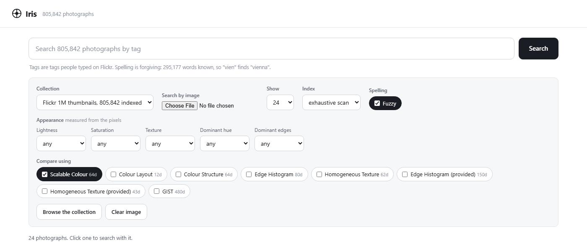
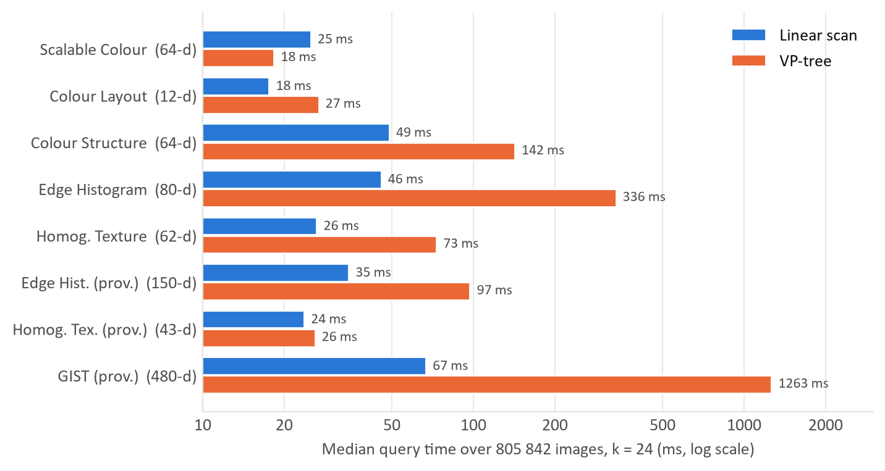
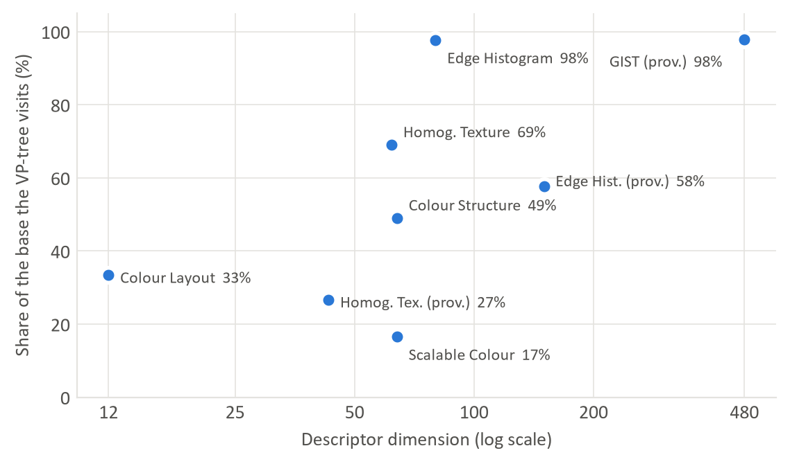
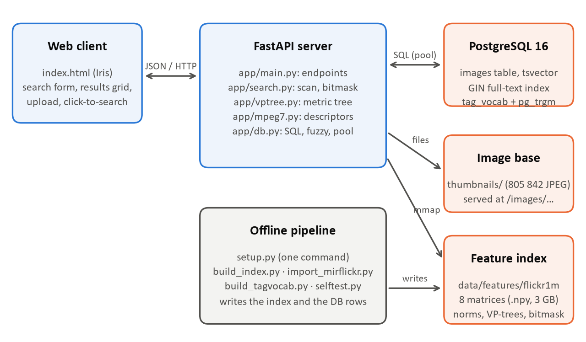

# Iris: Content-Based Image Retrieval over 805,842 Images

Iris is a complete search engine that finds images by what they look like. It indexes the 805,842 thumbnails of the MIRFLICKR-1M collection and answers three kinds of queries, alone or combined: **tags**, **visual properties** (for example `dark vivid blue`) and **example image**, from the base or uploaded. Every query answers in tens of milliseconds on a laptop, and the results are exact.



## 1. What This Project Achieved

1. Implemented five MPEG-7 descriptors from the pixels (colour, layout, texture, edges) and imported three provided ones, for 8 descriptors over the whole base.
2. Built an exact k-nearest-neighbour search that scans all 805,842 images in 18 to 67 ms with one BLAS product per descriptor.
3. Implemented a VP-tree (vantage-point metric tree) and measured where it beats the scan and where it loses.
4. Added PostgreSQL full-text search over real Flickr tags, with fuzzy matching for typos and partial words.
5. Added a visual-property filter that answers in about 2 ms over the whole base.
6. Wrapped everything in a FastAPI server, a single-page web client and a one-command setup.
7. Wrote 37 automated correctness checks that compare every search path with float64 ground truth.

## 2. Verified Results

| Measure | Result |
| --- | --- |
| Images indexed | 805,842 thumbnails, 8 descriptors, 3.0 GB of feature matrices |
| Images with real Flickr tags | 761,603 (94.5%) |
| Fuzzy-matching vocabulary | 295,177 words |
| Image query, one descriptor | 18 to 67 ms, exact scan of the whole base |
| Visual-property filter | about 2 ms over the whole base |
| Text query, fuzzy matching included | 3 to 100 ms |
| Scan vs VP-tree agreement | identical neighbours on 160 of 160 test queries |
| Self-test | 37 of 37 checks pass |

Measured on an Intel Core i7-13650HX laptop (16 GB RAM, Windows 11), medians of 10 to 20 queries after warm-up, k = 24.

## 3. Main Finding: the VP-tree Loses to a Linear Scan

The VP-tree is the metric index studied in the course. Both strategies are exact and return the same neighbours, but the tree is faster on only one descriptor out of eight.



The reason is the curse of dimensionality. At 12 to 64 dimensions the tree visits 17% to 49% of the base. At 80 and 480 dimensions it visits 98% of it: distances concentrate, so the triangle inequality excludes almost nothing. The tree then reads nearly the whole base in scattered order, while the scan reads it sequentially at memory bandwidth (GIST, 1.55 GB, in 67 ms).



Practical implication: the scan is the default, and the tree stays selectable in the interface so the comparison can be rerun.

## 4. Architecture



- **Web client** (`app/static/index.html`): search form, results grid, upload. Clicking a result searches with it.
- **FastAPI server** (`app/`): JSON API. At startup it memory-maps the feature matrices and opens a database connection pool.
- **PostgreSQL 16 in Docker**: one row per image, a GIN full-text index on the tags, and the fuzzy vocabulary with a trigram index.
- **Feature index** (`data/features/`): one N x D float32 matrix per descriptor, row norms, VP-trees and the visual-property bitmask. It loads in 0.38 s because it is mapped, not read.

Every query runs in two stages: an optional **filter** (tags and visual properties) builds a candidate set, then the **ranking** compares the query image with the candidates.

## 5. Pipeline Phases (What Was Done)

### Phase A: Lining up the dataset

Goal: attach the right tags and provided features to each image.

- Thumbnails start at `im1.jpg` and the archives at `0.txt`. Instead of assuming the offset, our Edge Histogram was correlated with the provided one at three offsets. Only `n - 1` matched (correlation 0.836, against about 0.24 for the others), which also validated our descriptor (cosine 0.94).
- The four archives (3 GB) are read in place, straight out of the zips, instead of unpacking four million small files.

### Phase B: Image descriptors

Goal: describe every image with fixed-length vectors.

| Descriptor | Kind | Dim | Source |
| --- | --- | --- | --- |
| Scalable Colour (`mp7_scd`) | colour: HSV histogram, Haar transform | 64 | computed |
| Colour Layout (`mp7_cld`) | colour: 8x8 DCT of YCbCr | 12 | computed |
| Colour Structure (`mp7_csd`) | colour: local colour structure (HMMD) | 64 | computed |
| Edge Histogram (`mp7_ehd`) | texture: 5 edge types x 16 sub-images | 80 | computed |
| Homogeneous Texture (`mp7_htd`) | texture: energy in 30 frequency channels | 62 | computed |
| `mp7_ehd_ref`, `mp7_htd_ref`, `gist` | texture and scene | 150 / 43 / 480 | provided with the dataset |

The computed descriptors also work on an uploaded image. Components on very different scales (Colour Layout, Homogeneous Texture) are divided by their standard deviation over the base, and the same divisors are applied to queries.

### Phase C: Exact nearest-neighbour search

Goal: rank 805,842 images per query, interactively.

- The distance is expanded as `‖q − x‖² = ‖x‖² − 2 q·x + ‖q‖²` with the norms precomputed, so a full scan is one matrix-vector product over the memory-mapped matrix.
- This identity loses precision in float32 when norms are large, so the scan pre-selects `max(4k, k + 64)` candidates and re-ranks them in float64. The returned top k is exact.
- The VP-tree splits each node at the median distance to a vantage point, stores leaves of 512 points, and prunes subtrees with the triangle inequality.

### Phase D: Text and fuzzy search

Goal: search the real Flickr tags, forgiving typos.

- Tags are a `tsvector` column with a GIN inverted index, words are ANDed and ranked with `ts_rank`.
- Each typed word is expanded against the 295,177-word vocabulary with a `pg_trgm` index: prefixes (`vien` finds `vienna`) and typos (`archtecture` finds `architecture`). Candidates are scored by similarity weighted by frequency, and the exact word is always searched too.

### Phase E: Visual-property filter

Goal: filter by appearance without a query image.

- Lightness, saturation, edge density, dominant hue and dominant edge direction are measured from the pixels and cut at terciles of the base, giving a closed vocabulary of 25 words.
- Each image's properties fit in one `uint32`, so a filter such as `dark vivid blue` is one vectorised comparison over a 3 MB array.

### Phase F: Combining everything

- Several descriptors: distances are min-max normalised and averaged (this always uses the scan, because the result is not a metric).
- Filter plus image: the ranking runs only inside the candidate set, gathering rows below 10% of the base and masking a full scan above.

## 6. Problems We Hit and How We Fixed Them

| Problem | Cause | Fix |
| --- | --- | --- |
| Every black-and-white image (7.4% of the base) had the same Scalable Colour vector | Keeping 64 of 256 coefficients merged bins along the fastest-varying axis, brightness | Ordered the bins hue-fastest: distinct vectors went from 18,529 to 19,999 in a 20,000-image sample |
| Wrong ranking on `mp7_htd_ref` | float32 error of the norm identity was larger than the gap between the 24th and 25th neighbour | Re-rank a candidate pool in float64, now checked by the self-test |
| Every image matched the word "jpg" | The file extension was indexed as a tag | Strip the extension before indexing |
| The "midtone" filter selected 79% of the base | Fixed lightness thresholds | Cut at terciles so each word selects a third |
| Colour Structure dominated indexing time | One loop per colour | Bitwise OR of 64-bit masks, six array operations |

## 7. Script Catalog

| Script | Purpose |
| --- | --- |
| `setup.py` | One-command setup: dependencies, `.env`, PostgreSQL, indexing, archive import, vocabulary, self-test. Re-runnable |
| `scripts/build_index.py` | Compute the descriptors and write the rows and the index |
| `scripts/import_mirflickr.py` | Load the tags and the provided descriptors from the zips |
| `scripts/build_tagvocab.py` | Build the fuzzy vocabulary (`--show <word>` explains one expansion) |
| `scripts/selftest.py` | 37 correctness checks against float64 ground truth |
| `scripts/evaluate.py` | Precision and recall at k on the synthetic labelled base |
| `scripts/make_dataset.py` | Generate the synthetic labelled base (3 shapes x 10 images) |

## 8. Reproducible Run Order

Requirements: Python 3.10 or newer, and Docker Desktop running (it only hosts PostgreSQL).

**1. Get the data.** Download from the [MIRFLICKR website](https://press.liacs.nl/mirflickr/) the 1M thumbnails and four archives: `tags.zip`, `features_edgehistogram.zip`, `features_homogeneoustexture.zip` and `features_gist.zip`. Place them next to this repository:

```
some-folder/
├── iris-cbir/          this repository
├── thumbnails/         1/, 2/, ... with im1.jpg, im2.jpg, ...
├── tags.zip
├── features_edgehistogram.zip
├── features_homogeneoustexture.zip
└── features_gist.zip
```

They can live elsewhere with `python setup.py --data <folder>` and `FLICKR_DIR=<path>` in `.env`.

**2. Create a virtual environment.**

```bash
python -m venv .venv
source .venv/bin/activate        # Windows: .venv\Scripts\Activate.ps1
```

**3. Build and serve.**

```bash
python setup.py                  # full base, about 15 minutes the first time
python -m uvicorn app.main:app --port 8000
```

Then open <http://127.0.0.1:8000>. To try it quickly, `python setup.py --quick --serve` indexes only 20,000 images (about 1 minute) and starts the server.

**4. Check it.**

```bash
python scripts/selftest.py flickr1m              # 37 correctness checks
python scripts/evaluate.py objects --k 9         # precision@k on the synthetic base
```

### Troubleshooting

| Problem | Fix |
| --- | --- |
| `Docker was not found` or `not responding` | Start Docker Desktop and wait for *Engine running* |
| Port 5432 already in use | Stop the other PostgreSQL, or change the port in `docker-compose.yml` and in `DATABASE_URL` in `.env` |
| `ModuleNotFoundError` when starting the server | The virtual environment is not active |
| Text search returns nothing | The tags were not imported: run `python setup.py` again |
| `no thumbnails found` | `thumbnails/` is not next to the repository: move it or set `FLICKR_DIR` in `.env` |

## 9. API

| Endpoint | Purpose |
| --- | --- |
| `GET /api/datasets` | Bases, image counts, visual facets, descriptors |
| `GET /api/browse` | A page of the base, to start browsing |
| `POST /api/search` | JSON body: keywords, visual properties, image id, descriptors, k, index, fuzzy |
| `POST /api/search/image` | Same as a multipart form, with an uploaded file as the query |

Every response returns the results (id, URL, tags, score) plus the strategy used, the number of vectors compared and the time taken.

## 10. Project Layout

```
iris-cbir/
├── app/              FastAPI server: main.py, search.py, vptree.py, mpeg7.py, db.py, static/index.html
├── scripts/          offline tools: indexing, import, vocabulary, self-test, evaluation
├── data/objects/     small synthetic labelled base for the precision evaluation
├── docs/             DESIGN.md (full design notes) and figures
├── setup.py          one-command setup
├── Dockerfile, docker-compose.yml, requirements.txt, .env.example
```

The feature index (`data/features/`, 3 GB) is not in the repository: `setup.py` builds it.

## 11. Limits and Next Steps

- Precision is measured only on the small synthetic base, because the Flickr base has no class labels.
- MPEG-7 descriptors capture colour, texture and layout, not meaning. Learned embeddings such as CLIP would capture semantics and allow text-to-image search without tags.
- To go faster in high dimension: read less data (PCA, float16, product quantisation) or use approximate indexes such as HNSW or IVF.
- Relevance feedback, so the user can mark good and bad results and re-weight the descriptors.

## 12. Credits and Licence

Built by Yesmine Haddar and Amir Triki at SUP'COM (École Supérieure des Communications de Tunis), academic year 2026 to 2027, supervised by Pr. Riadh Tebourbi.

The images, tags and provided descriptors come from the MIRFLICKR-1M collection (Mark J. Huiskes, Bart Thomee and Michael S. Lew, LIACS Medialab, Leiden University). They are not included in this repository, and each image keeps its own Flickr licence.

Code released under the MIT licence, see [LICENSE](LICENSE).
